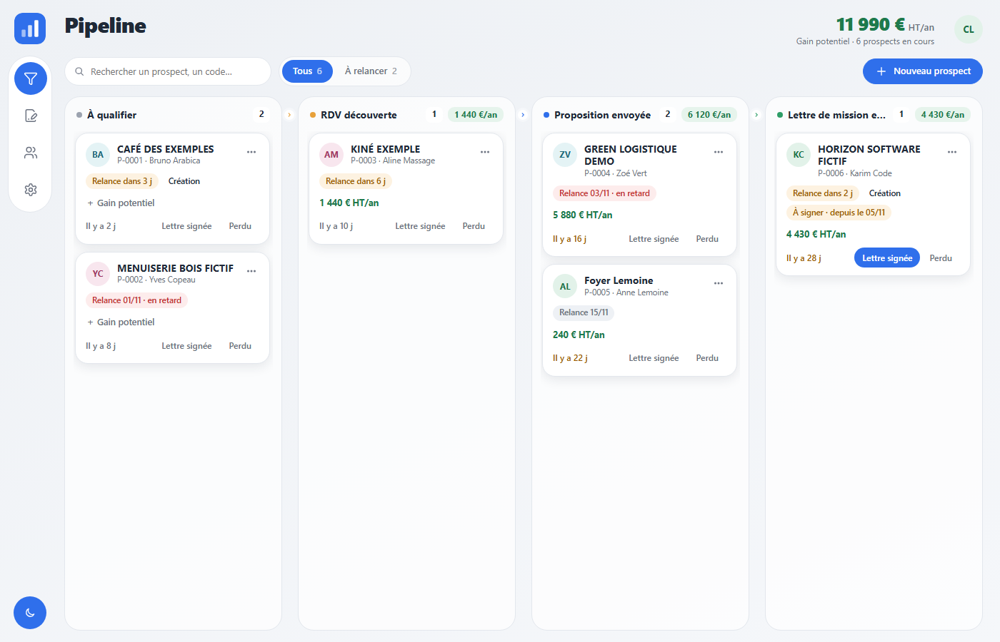
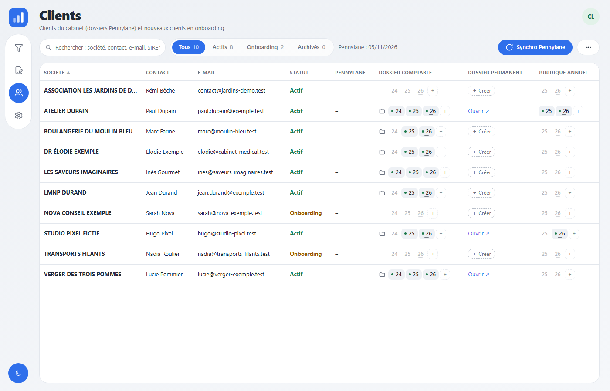
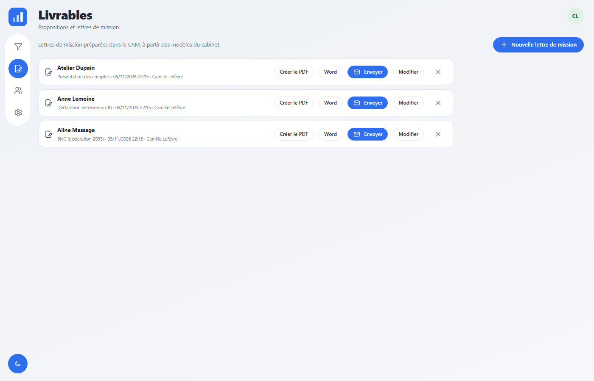

# CRM Cabinet

In a small accounting firm, getting a new client means juggling emails, follow-ups written down somewhere, an engagement letter copied from a Word template, folders created by hand in SharePoint, and client info split between Pennylane and SharePoint.
It's easy to forget a follow-up or send a letter with a blank left in it.

I built this CRM so the whole path, from first contact to signed engagement letter, lives in one place.

| Clients and SharePoint folders | Generated engagement letters |
|---|---|
|  |  |

## What it does

- **Prospect pipeline**, drag and drop across four stages, with follow-up reminders and a warning when one is overdue
- **Engagement letters**, the Word file is filled from the client record. Anything still missing stays highlighted in yellow, so nothing goes out half-done
- **Outlook**, each user connects their own mailbox, sees the emails with a prospect and can reply from the CRM
- **Clients**, synced from Pennylane (read-only), with their SharePoint folders created for each year

I wrote it in plain PHP 8 and JavaScript, without a framework, so it runs on basic shared hosting.
I also spent time on security, since it handles client data: hashed passwords, lockout after too many attempts, encrypted tokens, Microsoft sign-in.

This repo is the public version. The firm's branding, settings and letter templates have been replaced with fictional ones.

## Try it

You need PHP 8.1+ with the `dom`, `mbstring`, `openssl` and `zip` extensions. No account, no internet.

- Windows: `demo.bat`
- macOS / Linux: `./demo.sh`

Then open http://127.0.0.1:8080 (login `demo` / `demo`). The demo has 10 fake clients and 8 prospects. Microsoft 365 and Pennylane are switched off.

Tests (Python): `pip install pytest requests python-docx cryptography` then `python -m pytest tests -q`.
They run the real PHP server against fake Microsoft and Pennylane servers.

## Limits

- Data is stored in JSON files. Fine for a few users, but a bigger firm would need a real database.
- Microsoft 365 and Pennylane are only tested against simulated servers in this repo.
- The letter templates are fake and have no legal value.
- A few features (opening a folder in Explorer, reading Outlook signatures) only work on Windows.

The interface is in French, since it was made for a French firm.

MIT licence. Made by Mehdi Mobtahij.
